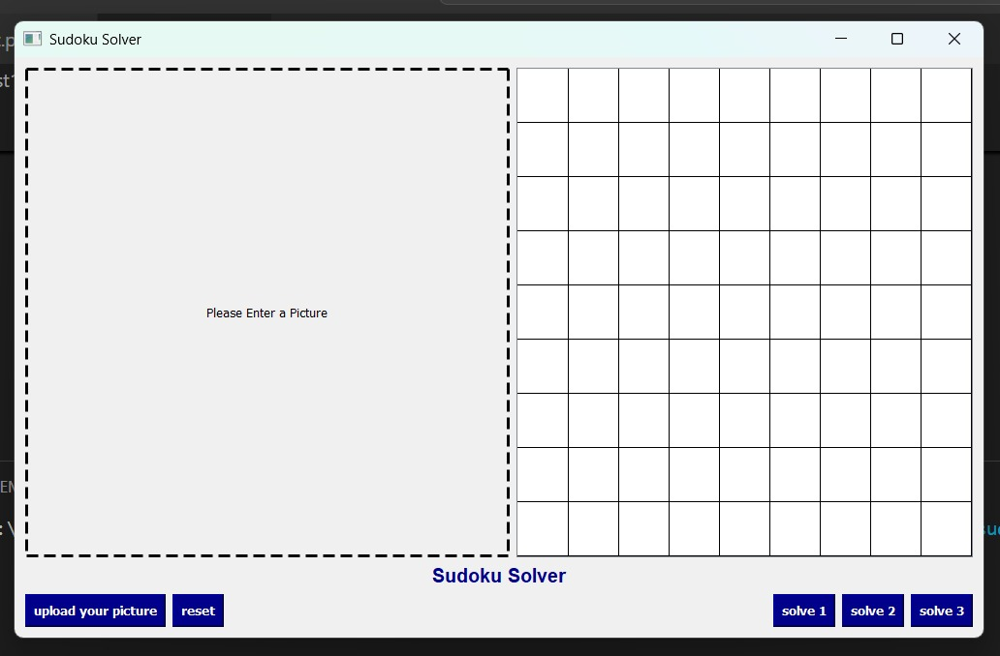
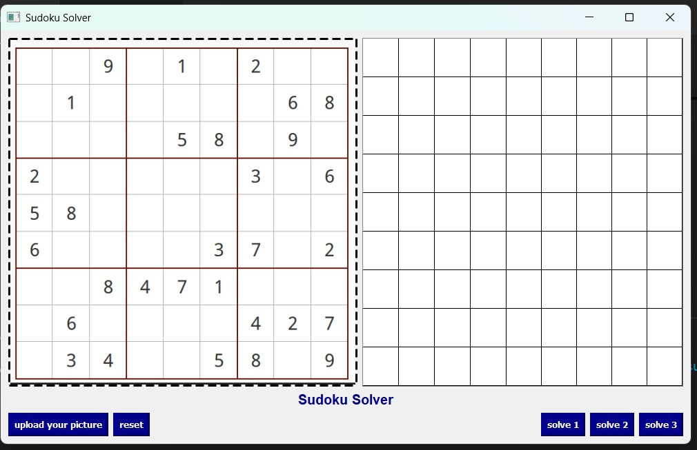
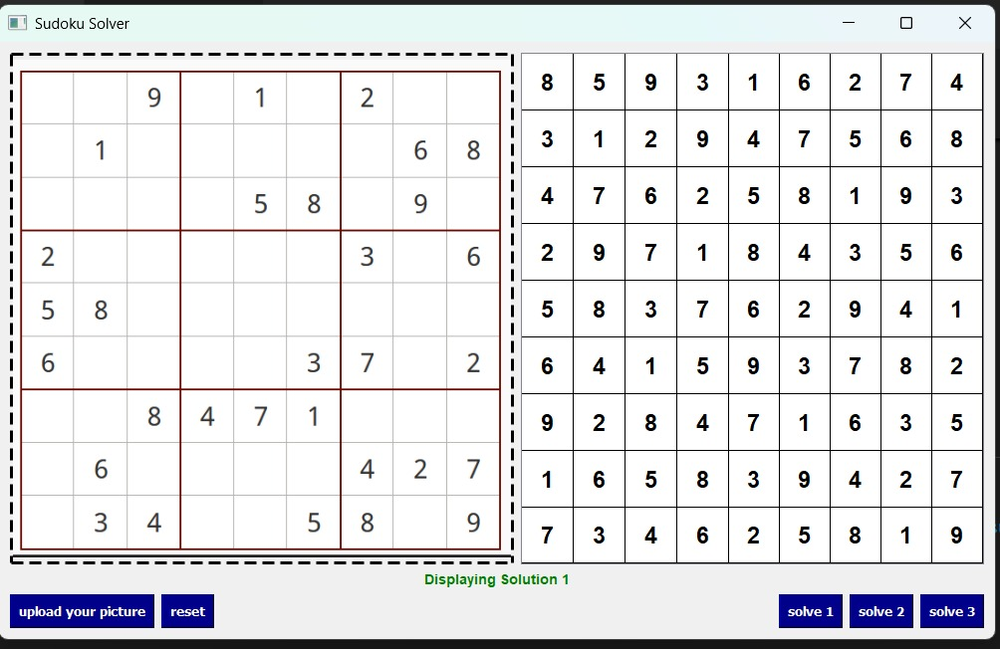

<h1 align="center">Sudoku Solver</h1>
<p align="center"><em>Sudoku Solvability through Backtracking Encoding</em></p>

<p align="center">
  
  
  
  
</p>

A Python application that solves Sudoku puzzles directly from a photo. The user uploads an image; the system preprocesses it, extracts the digits with AI-based OCR, and computes the solution with a recursive backtracking solver — all through a clean PyQt5 interface, with no manual data entry.

## Table of Contents

- [Features](#features)
- [Tech Stack](#tech-stack)
- [How It Works](#how-it-works)
- [Usage](#usage)
- [Screenshots](#screenshots)
- [Conclusion](#conclusion)
- [References](#references)

## Features

- **Image-based input** – solve a puzzle from a photo instead of typing it in.
- **Robust preprocessing** – handles noise, uneven lighting, and tilted boards.
- **AI-powered OCR** – Google Gemini reads the whole grid in context, reducing errors from fonts, noise, or low resolution.
- **Fast solver** – recursive backtracking returns solutions in milliseconds.
- **Multiple solutions** – detects and displays up to 3 valid solutions.
- **Responsive GUI** – color-coded status feedback and a UI that stays responsive during processing.

## Tech Stack

| Library | Role |
|---|---|
| **OpenCV** | Image preprocessing: grayscale, Gaussian blur, adaptive thresholding, perspective transform |
| **Google Generative AI** | Gemini model used as the OCR engine; returns the grid as JSON |
| **PyQt5** | Graphical user interface |
| **NumPy** | Image data as arrays; extraction of the 9×9 grid |
| **Pillow** | Ensures correct image format before sending it to the API |
| **json, os, sys, copy** | Parsing API output, file handling, clean exit, and storing independent solution copies (`deepcopy`) |

## How It Works

```
Photo → Preprocessing (OpenCV) → OCR (Gemini) → 9×9 grid → Backtracking solver → GUI
```

### 1. Image Preprocessing

1. Convert the image to grayscale.
2. Apply Gaussian blur to reduce high-frequency noise.
3. Apply adaptive thresholding to separate grid lines from the background.
4. Detect and filter contours to locate the Sudoku board.
5. Apply a perspective transform to obtain a flat, top-down view.
6. Resize and denoise so the digits are clear for OCR.

### 2. AI-Based OCR

A carefully designed prompt instructs Gemini to return **only** a JSON object with the 9×9 grid, where empty cells are `0`. The JSON is converted into a Python 2D list (`self.grid`), which is the input of the solver.

### 3. Backtracking Solver

The solver builds the solution step by step and abandons a path as soon as it cannot lead to a valid solution.

1. **Find** the first empty cell (`0`).
2. **Try** numbers 1–9.
3. **Validate** (`is_valid`): the number must not already exist in the row, the column, or the 3×3 subgrid.
4. **Recurse** on the rest of the grid if the number is valid.
5. **Backtrack**: if no number fits, reset the cell to `0` and return to the previous step.
6. **Multiple solutions**: each complete solution is saved with `copy.deepcopy()` while the search continues, up to 3 solutions.

### 4. User Interface

- Built programmatically with `QVBoxLayout` / `QHBoxLayout` (no Qt Designer or `.ui` files).
- Images are displayed with `QPixmap`, scaled while keeping the aspect ratio.
- The solution grid is a `QTableWidget` mapped directly from the `self.grid` array.
- `QApplication.processEvents()` keeps the UI responsive during API calls and solving.
- Status label colors: **blue** – processing, **green** – success, **red** – error.

## Usage

1. Click **upload your picture** and select a Sudoku image.
2. Click **solve 1** to extract the grid and display the first solution.
3. Click **solve 2** / **solve 3** to view alternative solutions, if any.
4. Click **reset** to start over.

## Screenshots

| Main interface | Image loaded | Solved |
|:---:|:---:|:---:|
|  |  |  |
| Initial state, waiting for a picture | Uploaded puzzle shown on the left | Solution displayed on the right grid |

## Conclusion

The project combines traditional computer vision with modern generative AI to deliver a practical Sudoku solver: reliable digit extraction from imperfect images, millisecond-level solving with multi-solution support, and a responsive, modular PyQt5 interface.
